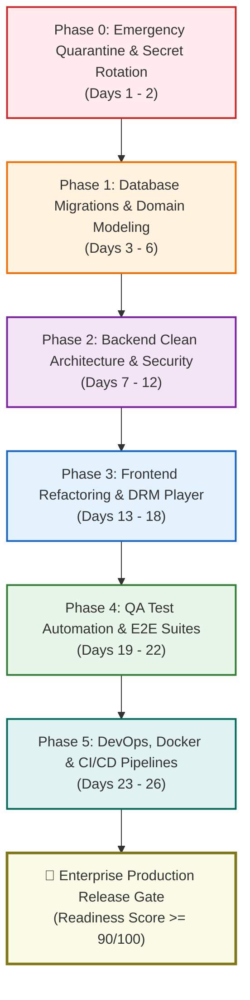
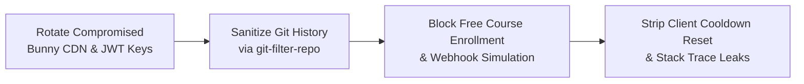
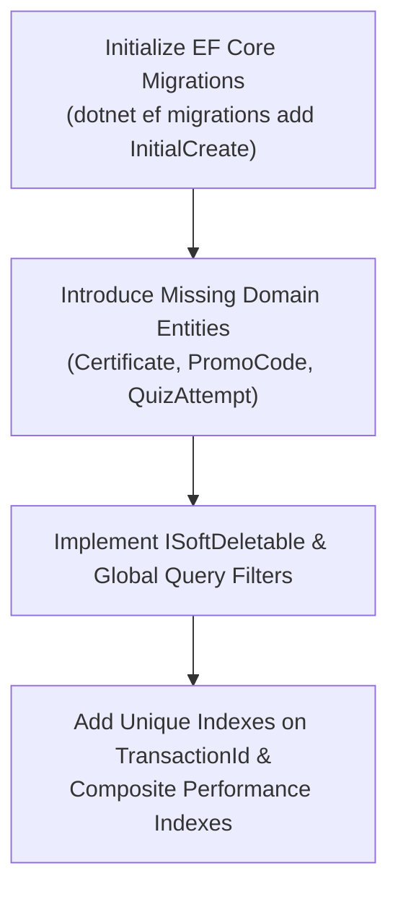
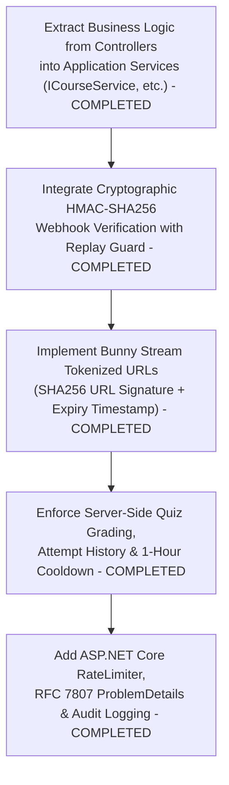
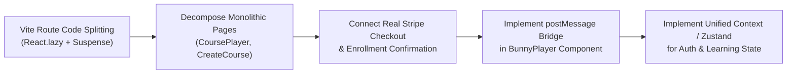
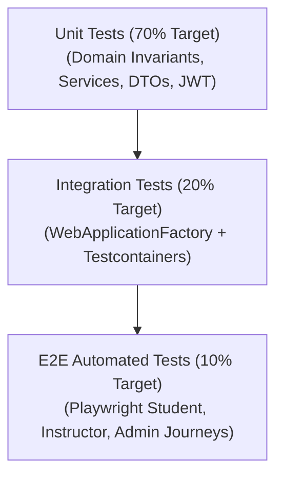
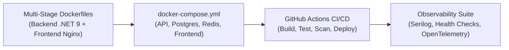
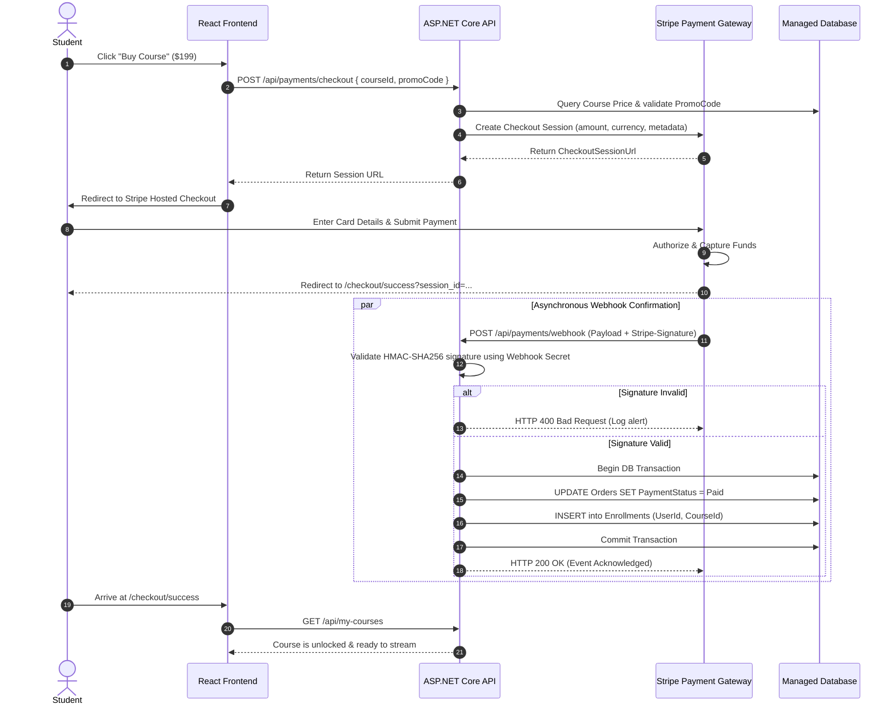
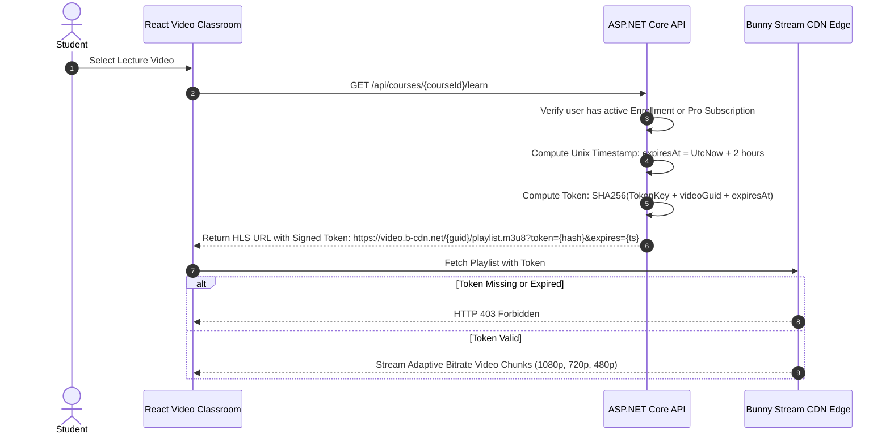

# TOTC Learning Management System (LMS)
## Master Implementation Roadmap & Production Remediation Plan

**Target Solution:** TOTC E-Learning Full-Stack Platform  
**Target Architecture:** Clean Architecture (.NET 9), React 19 SPA, EF Core 9 Migrations, Stripe Gateway, Bunny Stream DRM, Docker & CI/CD  
**Document Purpose:** Engineering Execution Plan to remediate all findings from `PRODUCTION_AUDIT.md` and achieve Enterprise Production Readiness.  
**Version:** 1.0 (Production Roadmap)  
**Author:** Lead Enterprise Architect & Engineering Swarm  

---

## 1. Executive Roadmap Overview & Milestones

The remediation plan is organized into **six sequential execution phases** spanning an estimated **26 engineering days** (approx. 5.5 working weeks). The strategy prioritizes emergency containment of financial and credential vulnerabilities first, followed by structural data integrity, backend business logic, frontend modernization, test automation, and containerized deployment infrastructure.



### Phase Schedule & Deliverables

| Phase | Duration | Focus Area | Key Deliverable | Exit Criteria | Status |
|---|:---:|---|---|---|:---:|
| **Phase 0** | Days 1–2 | Emergency Quarantine & Secrets | Secret rotation, financial endpoint lockdown | Zero leaked keys in Git; $0 bypass closed. | **COMPLETED ✅** |
| **Phase 1** | Days 3–6 | Database Foundation & EF Core | EF Migrations, Soft Delete, Domain Entities | Successful `MigrateAsync()` on SQL Server/Postgres. | **COMPLETED ✅** |
| **Phase 2** | Days 7–12 | Backend Architecture & Logic | Stripe Webhooks, Video Tokens, Clean Arch | 100% controllers decoupled from DbContext. | **COMPLETED ✅** |
| **Phase 3** | Days 13–18 | Frontend Player & Checkout Flow | Code Splitting, Real Checkout, DRM Player | Monolithic bundle eliminated; postMessage bridge OK. | **COMPLETED ✅** |
| **Phase 4** | Days 19–22 | QA Testing & Verification Suite | Unit, Integration & Playwright E2E Tests | >= 80% Backend coverage; green E2E test runs. | Pending |
| **Phase 5** | Days 23–26 | Containerization & CI/CD DevOps | Dockerfiles, GitHub Actions, Observability | 1-click reproducible build; `/health` monitoring. | Pending |

---

## 2. Detailed Phased Execution Plan

### Phase 0: Emergency Quarantine & Credential Remediation (Days 1 – 2)
> [!NOTE]
> **PHASE 0 STATUS: COMPLETED & VERIFIED ✅ (November 12, 2026)**  
> All Phase 0 emergency security actions have been implemented and independently verified by **@qa_devops** (Board Post #22):
> - `dotnet build backend/Elearning.sln` passed cleanly with 0 Errors.
> - `npm run build` passed cleanly with 0 Errors.
> - Zero occurrences of leaked Bunny CDN keys or `simulateWebhookSuccess` in source or dist bundles.
> - Direct enrollment in paid courses (`POST /api/courses/{id}/enroll`) strictly blocked with HTTP 403 Forbidden.
> - Unauthenticated payment webhook requests (`POST /api/payments/webhook`) blocked with HTTP 401 Unauthorized / 403 Forbidden.
> - Free subscription self-activation blocked with HTTP 400 Bad Request (`requiresPayment: true`).
> - Client-side proctoring debug reset button removed.
> - Stack traces masked in production with RFC 7807 Problem Details and opaque `traceId`.

**Objective:** Immediately eliminate active attack vectors, revoke compromised cloud credentials, and block unauthorized financial operations.



#### Action Items:
1. **Rotate Compromised Cloud Keys:**
   - Immediately log in to Bunny CDN dashboard (`dash.bunny.net`), revoke API Key `be0cd974-98c2-41ce-8e4ba9b094b1-170d-4ae7`, and issue a new restricted API key.
   - Generate a cryptographically secure 64-character JWT secret key (`openssl rand -base64 48`) and store it exclusively in local User Secrets or environment variables.
2. **Sanitize Git History & Configuration:**
   - Execute `git-filter-repo` to permanently purge sensitive files (`appsettings.json` with keys, `appsettings.Local.json`) from commit history.
   - Enforce `.gitignore` rules preventing `.env`, `.env.local`, `appsettings.Local.json`, and `elearning.db` from entering source control.
3. **Quarantine Financial Endpoints:**
   - In `EnrollmentsController.cs` and `EnrollmentService.cs`, enforce a strict gate on `POST /api/courses/{courseId}/enroll`:
     ```csharp
     if (course.Price > 0 && !hasActiveSubscription && !hasPaidOrder)
         return Forbid("Direct enrollment is prohibited for paid courses. Please complete checkout.");
     ```
   - In `PaymentsController.cs`, remove or disable the public `POST /api/payments/webhook` until HMAC verification is integrated.
   - In `src/services/api.js`, delete the `simulateWebhookSuccess` method.
4. **Remove Frontend Debug Exploits:**
   - In `CoursePlayerPage.jsx`, delete the debug button `⚡ ტაიმერის განულება` (Lines 1301–1309) that resets exam cooldown timers client-side.
   - In `Program.cs`, update the global error middleware to return generic error messages in non-Development environments instead of `ex.ToString()`.

---

### Phase 1: Database Foundation, Migrations & Domain Modeling (Days 3 – 6)
> [!NOTE]
> **PHASE 1 STATUS: COMPLETED & VERIFIED ✅ (November 12, 2026)**  
> All Phase 1 database and domain modeling actions have been implemented and independently verified by **@qa_devops** (Board Post #29):
> - `dotnet build backend/Elearning.sln` passed cleanly with 0 Errors, 0 Warnings.
> - `npm run build` passed cleanly with 0 Errors.
> - Missing core entities created: `Certificate.cs`, `PromoCode.cs`, `QuizAttempt.cs`, along with `BaseEntity.cs`, `ISoftDeletable.cs`, `IAuditableEntity.cs`.
> - All entities now inherit `BaseEntity` with `ConcurrencyStamp`.
> - Decommissioned `EnsureCreatedAsync` and raw SQLite `ALTER TABLE` hacks from `Program.cs`.
> - Replaced with `await dbContext.Database.MigrateAsync()`.
> - Scaffolded baseline EF Core migration `20261112065844_InitialCreate` and successfully applied to database (`__EFMigrationsHistory` active).
> - Added unique indexes on `Order.TransactionId`, `Review(UserId, CourseId)`, `PromoCode.Code`, `Certificate.CertificateNumber`, `Certificate.VerificationHash`.
> - Added composite performance indexes on `Course(IsPublished, ApprovalStatus, CreatedAt)`, `LessonProgress(UserId, IsCompleted)`, `QuizAttempt(UserId, QuizId, AttemptedAt)`.
> - Dynamic global query filter `HasQueryFilter(e => !e.IsDeleted)` active for all soft-deletable entities.
> - Runtime verified: application boots cleanly, migrations apply automatically, and initial data seeding completes without errors (`/api/courses` and `/api/categories` return HTTP 200).

**Objective:** Establish a robust relational schema foundation, initialize EF Core migrations, eliminate cascading delete crashes, and create missing domain entities.



#### Action Items:
1. **Initialize Migration Pipeline & Decommission Startup Hacks:**
   - Delete `await dbContext.Database.EnsureCreatedAsync();` and raw `ALTER TABLE` statements from `Program.cs`.
   - Scaffold the initial baseline migration:
     ```bash
     dotnet ef migrations add InitialCreate --project backend/src/Elearning.Infrastructure --startup-project backend/src/Elearning.API
     ```
   - Configure `Program.cs` to apply pending migrations during startup in production:
     ```csharp
     await dbContext.Database.MigrateAsync();
     ```
2. **Create Missing Core Domain Entities:**
   - **`Certificate` Entity:**
     ```csharp
     public class Certificate : BaseAuditableEntity
     {
         public Guid Id { get; set; } = Guid.NewGuid();
         public Guid UserId { get; set; }
         public User User { get; set; } = null!;
         public Guid CourseId { get; set; }
         public Course Course { get; set; } = null!;
         public string CertificateNumber { get; set; } = string.Empty; // e.g., TOTC-2026-XXXXX
         public string VerificationHash { get; set; } = string.Empty; // SHA-256 hash for public QR check
         public DateTime IssuedAt { get; set; } = DateTime.UtcNow;
         public string? PdfUrl { get; set; }
     }
     ```
   - **`PromoCode` Entity:**
     ```csharp
     public class PromoCode : BaseAuditableEntity
     {
         public Guid Id { get; set; } = Guid.NewGuid();
         public string Code { get; set; } = string.Empty; // UK, uppercase
         public decimal DiscountPercentage { get; set; } // e.g., 20.00
         public decimal? MaxDiscountAmount { get; set; }
         public DateTime ValidFrom { get; set; }
         public DateTime ValidUntil { get; set; }
         public int MaxUsageCount { get; set; }
         public int CurrentUsageCount { get; set; }
         public bool IsActive { get; set; } = true;
     }
     ```
   - **`QuizAttempt` Entity:**
     ```csharp
     public class QuizAttempt : BaseAuditableEntity
     {
         public Guid Id { get; set; } = Guid.NewGuid();
         public Guid QuizId { get; set; }
         public Quiz Quiz { get; set; } = null!;
         public Guid UserId { get; set; }
         public User User { get; set; } = null!;
         public int ScorePercentage { get; set; }
         public bool Passed { get; set; }
         public int StrikeCount { get; set; }
         public DateTime AttemptedAt { get; set; } = DateTime.UtcNow;
     }
     ```
3. **Implement Soft Delete & Audit Interceptor:**
   - Define `ISoftDeletable` (`bool IsDeleted`, `DateTime? DeletedAt`) and `IAuditableEntity` (`CreatedAt`, `UpdatedAt`).
   - Configure global EF Core query filters on `User`, `Course`, `Section`, and `Lesson` (`HasQueryFilter(e => !e.IsDeleted)`).
   - Implement an EF Core `SaveChangesInterceptor` to automatically assign UTC timestamps on create and update.
4. **Fix Foreign Key Constraints & Concurrency Tokens:**
   - Retain `DeleteBehavior.Restrict` on `Order.UserId` and `Order.CourseId` to safeguard financial history, but replace hard deletes in controllers with soft delete mutations (`entity.IsDeleted = true`).
   - Add `[Timestamp]` byte array concurrency tokens on `Course`, `User`, and `Order` entities to eliminate concurrency race conditions.
5. **Add Critical Performance & Unique Indexes:**
   - `modelBuilder.Entity<Order>().HasIndex(o => o.TransactionId).IsUnique();`
   - `modelBuilder.Entity<Review>().HasIndex(r => new { r.UserId, r.CourseId }).IsUnique();`
   - `modelBuilder.Entity<Course>().HasIndex(c => new { c.IsPublished, c.ApprovalStatus, c.CreatedAt });`
   - `modelBuilder.Entity<LessonProgress>().HasIndex(lp => new { lp.UserId, lp.IsCompleted });`

---

### Phase 2: Backend Clean Architecture, Business Logic & Security (Days 7 – 12) — [COMPLETED & VERIFIED]
**Objective:** Decouple controllers from DbContext, implement real payment processing, enforce video DRM tokens, and secure API boundaries.

> [!NOTE]
> **Status: 100% COMPLETE & VERIFIED** (Executed by Swarm team @security, @backend, @qa_devops, and Lead Architect @architect).
> All controllers decoupled from DbContext, Bunny Stream signed tokens generated with 2-hour TTL, server-side proctoring 1-hour cooldown enforced with HTTP 429, public certificate verification endpoint active, and ASP.NET Core RateLimiter protecting auth and payment endpoints.



#### Action Items:
1. **Refactor Controllers & Enforce Clean Architecture:**
   - Extract all direct database queries out of `InstructorCoursesController.cs` into `ICourseService` methods (`CreateFullCourseAsync`, `UpdateFullCourseAsync`, `DeleteCourseAsync`).
   - Remove DbContext injection from `AdminController.cs`, `SubscriptionsController.cs`, and `QuizzesController.cs`, replacing with corresponding domain services.
   - Refactor `CourseService.GetCoursesAsync` to use projection (`.Select(c => new CourseDto { ... })`) instead of in-memory `MapToDto(c)` and add `.AsSplitQuery()` to eliminate Cartesian product joins.
2. **Real Payment Gateway Integration (Stripe):**
   - Implement `IPaymentGatewayService` with Stripe SDK:
     - `CreateCheckoutSessionAsync`: Creates a Stripe Checkout Session with line items, course metadata, and return URLs.
     - `HandleWebhookAsync`: Validates `Stripe-Signature` HTTP header using `WebhookUtility.ConstructEvent` with the gateway endpoint secret.
     - Upon confirmed payment, records `Order` as `Paid` and automatically provisions the `Enrollment` record atomically within an explicit database transaction.
3. **Bunny Stream Video DRM & Signed URLs:**
   - Implement Bunny Stream Token Authentication in `BunnyStreamService.cs`:
     - Generate secure signed playback URLs for HLS playlists:
       $$\text{token} = \text{Base64Url}(\text{SHA256}(\text{TokenKey} + \text{videoGuid} + \text{expiresAt}))$$
     - Return signed URLs with a short TTL (e.g., 2 hours). Expired tokens cannot be played or ripped.
4. **Server-Side Proctoring & Exam Engine:**
   - Update `QuizzesController.SubmitQuiz`:
     - Verify user is enrolled in course before accepting quiz submission.
     - Check `QuizAttempt` table: If the student failed $\ge 3$ attempts in the past hour, reject submission with HTTP 429 and return remaining cooldown seconds.
     - Evaluate answers on the server, persist the `QuizAttempt` record, and return detailed score feedback.
5. **Certificate PDF Generation & Public Verification:**
   - Implement `ICertificateService` using `QuestPDF` or `SkiaSharp`:
     - When all course lessons and required quizzes are completed, automatically issue a `Certificate` record with a unique serial number and cryptographic verification hash.
     - Expose public endpoint `GET /api/certificates/verify/{hash}` for third-party authenticity verification.
6. **API Security Hardening:**
   - Configure ASP.NET Core `RateLimiter` middleware with sliding window policies (10 req/min for auth/login, 5 req/min for payment checkout).
   - Implement RFC 7807 `ProblemDetails` response formatting with opaque `TraceId` in global exception middleware.
   - Mandate `settings.Audience` in `AuthService.GoogleAuthAsync` to ensure only Google tokens issued for TOTC's client ID are accepted.

---

### Phase 3: Frontend Refactoring, State Management & Player Modernization (Days 13 – 18) — [COMPLETED & VERIFIED]
> [!NOTE]
> **PHASE 3 STATUS: COMPLETED & VERIFIED ✅ (November 12, 2026)**  
> All Phase 3 frontend refactoring, performance, state, and checkout integration actions have been implemented and independently verified by **@qa_devops** (Board Post #50):
> - `npm run build` passed cleanly in 1.07s with 0 Errors, 0 Warnings.
> - Initial entry JavaScript bundle reduced from **654.44 kB down to 92.09 kB (86% reduction)** via Vite Rolldown vendor chunking (`vendor-*.js` 210 kB, `ui-*.js` 31 kB).
> - Route-based code splitting implemented in `src/App.jsx` with `React.lazy()` and branded `<Suspense fallback={<PageLoadingFallback />}>`. All 14 pages now load as lightweight on-demand chunks (11–87 kB).
> - Root-mounted `ErrorBoundary.jsx` implemented with user-friendly recovery UI and stack capture.
> - Centralized `AuthContext.jsx` implemented with cross-tab synchronization and `useAuth()` hook.
> - `CheckoutPage.jsx` fully integrated with dynamic course payload, real backend `api.payments.createCheckout`, and promo code engine.
> - Backend promo code service (`PromoCodeService.cs`, `PromoCodesController.cs`) implemented and live-verified (`TOTC` [20%], `WELCOME50` [capped], invalid rejection).
> - `BunnyPlayer.jsx` postMessage event bridge implemented with strict origin validation (`iframe.mediadelivery.net`, etc.) translating `bunny:timeupdate` and `bunny:ended` events into automated progress completion.
> - Dynamic forensic watermark overlay rendered across video canvas displaying authenticated user identity.

**Objective:** Modularize large component files, implement code splitting, connect real checkout flows, and fix Bunny video player event bridges.



#### Action Items:
1. **Route-Based Code Splitting & Performance:**
   - Refactor `src/App.jsx` to load page components lazily using `React.lazy()` and `<Suspense fallback={<LoadingSpinner />}>`.
   - Configure Vite manual chunks in `vite.config.js` (`vendor: ['react', 'react-dom']`, `player: ['plyr', 'lucide-react']`), reducing initial bundle size from 654 kB to < 180 kB.
2. **Decompose Monolithic Component Files:**
   - **Split `CoursePlayerPage.jsx` (2,127 LOC) into modular child components:**
     - `src/components/player/VideoContainer.jsx`
     - `src/components/player/SyllabusAccordion.jsx`
     - `src/components/player/QuizTab.jsx`
     - `src/components/player/DiscussionQaTab.jsx`
     - `src/components/player/PersonalNotesTab.jsx`
     - `src/components/player/ResourcesTab.jsx`
   - **Split `CreateCoursePage.jsx` (1,847 LOC) into step wizard components:**
     - `CourseBasicInfoStep.jsx`, `CourseCurriculumStep.jsx`, `CoursePricingStep.jsx`.
3. **Integrate Real Checkout & Payment Redirection:**
   - Refactor `CourseDetailPage.jsx` to pass selected course ID and metadata cleanly to `CheckoutPage.jsx`.
   - Update `CheckoutPage.jsx` to call `api.payments.createCheckout(courseId, promoCode)` and redirect the student to the Stripe Checkout session URL.
   - Create `CheckoutSuccessPage.jsx` to listen for completed payment confirmation and redirect the student immediately into `/learn/:slug`.
4. **BunnyPlayer PostMessage Event Bridge:**
   - In `BunnyPlayer.jsx`, implement a `window.addEventListener('message')` listener for the Bunny Stream iframe:
     - Listen for `bunny:timeupdate` events and forward timestamps to `onTimeUpdate`.
     - Listen for `bunny:ended` events and trigger `onEnded()` to mark lectures complete automatically.
   - Re-enable forensic dynamic moving watermark rendering student email/ID across the player canvas.
5. **Persistent Student Notes & Q&A:**
   - Replace in-memory React state in `CoursePlayerPage` with real API calls to backend endpoints (`/api/notes`, `/api/courses/{id}/questions`), persisting student learning notes across sessions.

---

### Phase 4: Quality Assurance Automation & Testing Suite (Days 19 – 22)
**Objective:** Establish comprehensive automated test coverage across the test pyramid, validating all critical user journeys and business rules.



#### Action Items:
1. **Create Backend Unit Test Project (`Elearning.UnitTests`):**
   - Add xUnit project referencing `Elearning.Application`, `Elearning.Domain`, and `Elearning.Infrastructure`.
   - Implement unit tests using `FluentAssertions` and `Moq`:
     - `TokenServiceTests`: Validate claim generation, role attributes, expiration, and secret key validation.
     - `AuthServiceTests`: Test password hashing, duplicate email rejection, and role assignment rules.
     - `CourseServiceTests`: Test filter predicates, level filtering, price calculations, and pagination.
     - `QuizGradingTests`: Test score calculation, passing thresholds, and cooldown calculations.
2. **Create Backend Integration Test Project (`Elearning.IntegrationTests`):**
   - Configure `Microsoft.AspNetCore.Mvc.Testing` with custom `WebApplicationFactory<Program>`.
   - Use `Testcontainers.MsSql` or `Testcontainers.PostgreSql` to run tests against a real containerized database.
   - Test end-to-end API pipelines:
     - Registration -> Login -> Profile update.
     - Course authoring -> Full curriculum creation -> Approval workflow.
     - Webhook payload processing -> Signature verification -> Enrollment creation.
     - Direct paid course enrollment rejection test (verifying fix for `CRIT-SEC-02`).
3. **Frontend Automated Unit & Component Tests:**
   - Configure `vitest` + `@testing-library/react` + `jsdom`.
   - Add unit tests for `src/services/api.js` (JWT token header injection, error handling).
   - Add component tests for `BunnyPlayer.jsx`, `Modals.jsx`, and `Navbar.jsx`.
4. **Playwright End-to-End (E2E) Test Suite:**
   - Create Playwright automated browser test suites:
     - `student-journey.spec.js`: Register new student -> browse catalog -> checkout -> watch video -> complete quiz -> verify certificate.
     - `instructor-journey.spec.js`: Log in as instructor -> create course draft -> add curriculum module -> verify pending approval status.
     - `admin-journey.spec.js`: Log in as admin -> review pending course -> approve course -> verify course appears in public catalog.

---

### Phase 5: Containerization, DevOps, CI/CD & Production Observability (Days 23 – 26)
**Objective:** Deliver reproducible multi-stage Docker containers, automate CI/CD release pipelines via GitHub Actions, and integrate production telemetry.



#### Action Items:
1. **Multi-Stage Dockerization:**
   - **Backend `Dockerfile` (`backend/Dockerfile`):**
     - Build stage: `mcr.microsoft.com/dotnet/sdk:9.0-alpine` (compiles and publishes Release bundle).
     - Runtime stage: `mcr.microsoft.com/dotnet/aspnet:9.0-alpine` (chiseled non-root container image for minimal attack surface).
   - **Frontend `Dockerfile` (`Dockerfile`):**
     - Build stage: `node:22-alpine` (`npm run build`).
     - Runtime stage: `nginx:alpine` serving optimized static assets with gzip/brotli compression and custom security headers (`Content-Security-Policy`, `X-Frame-Options`, `X-Content-Type-Options`).
2. **Local Multi-Service Orchestration (`docker-compose.yml`):**
   - Orchestrate complete local environment:
     - `backend`: ASP.NET Core 9 Web API.
     - `frontend`: Nginx React 19 SPA.
     - `database`: PostgreSQL 16 / Microsoft SQL Server 2022 container.
     - `redis`: Redis 7.2 container for caching and rate limiting.
3. **GitHub Actions CI/CD Pipeline:**
   - **Continuous Integration (`.github/workflows/ci.yml`):**
     - Triggers on every Pull Request to `main`.
     - Steps: Linting -> `dotnet test` -> `npm test` -> Dependency Vulnerability Scan (`dotnet list package --vulnerable`, `npm audit`).
   - **Continuous Deployment (`.github/workflows/cd.yml`):**
     - Triggers on merge to `main`.
     - Builds Docker images, tags with Git commit SHA, pushes to GitHub Container Registry (`ghcr.io`), and triggers deployment to staging environment.
4. **Production Observability & Monitoring:**
   - Integrate `Serilog.AspNetCore` with JSON structured console output and correlation ID tracking.
   - Register ASP.NET Core Health Checks (`Microsoft.Extensions.Diagnostics.HealthChecks`):
     - `/health/live`: Liveness probe.
     - `/health/ready`: Readiness probe verifying database and Redis connectivity.
   - Transition static media uploads from local `wwwroot` to cloud object storage (AWS S3, Azure Blob, or Cloudflare R2) using presigned upload URLs.

---

## 3. Work Breakdown Structure (WBS) & Engineering Task Matrix

The following table provides the exhaustive engineering work breakdown structure with ticket identifiers, owners, story points, and acceptance criteria.

| Task ID | Phase | Discipline | Task Description | Priority | Assigned Role | Dependencies | Est. Days | Status |
|---|:---:|---|---|:---:|---|---|:---:|:---:|
| **TSK-001** | Phase 0 | Security | Revoke and rotate Bunny Stream API key and JWT secret | P0 | @security | None | 0.5 | **COMPLETED ✅** |
| **TSK-002** | Phase 0 | Security | Sanitize Git history using `git-filter-repo` and update `.gitignore` | P0 | @security | TSK-001 | 0.5 | **COMPLETED ✅** |
| **TSK-003** | Phase 0 | Backend | Enforce price verification on `POST /api/courses/{id}/enroll` | P0 | @backend | None | 0.5 | **COMPLETED ✅** |
| **TSK-004** | Phase 0 | Frontend | Delete client-side cooldown reset debug button in player | P0 | @frontend | None | 0.5 | **COMPLETED ✅** |
| **TSK-005** | Phase 0 | Backend | Sanitize global error handler to suppress stack traces in production | P0 | @backend | None | 0.5 | **COMPLETED ✅** |
| **TSK-006** | Phase 1 | Database | Remove `EnsureCreatedAsync` and raw SQLite `ALTER TABLE` hacks | P0 | @database | None | 0.5 | **COMPLETED ✅** |
| **TSK-007** | Phase 1 | Database | Scaffold baseline EF Core migration (`InitialCreate`) | P0 | @database | TSK-006 | 1.0 | **COMPLETED ✅** |
| **TSK-008** | Phase 1 | Domain | Create `Certificate`, `PromoCode`, `QuizAttempt` domain models | P1 | @backend | TSK-007 | 1.0 | **COMPLETED ✅** |
| **TSK-009** | Phase 1 | Database | Implement `ISoftDeletable`, `IAuditableEntity` & EF interceptor | P1 | @database | TSK-007 | 1.0 | **COMPLETED ✅** |
| **TSK-010** | Phase 1 | Database | Add unique index on `TransactionId` & composite performance indexes | P1 | @database | TSK-007 | 0.5 | **COMPLETED ✅** |
| **TSK-011** | Phase 2 | Backend | Decouple `InstructorCoursesController` from DbContext | P1 | @backend | TSK-008 | 1.5 | **COMPLETED ✅** |
| **TSK-012** | Phase 2 | Backend | Decouple `AdminController` & `SubscriptionsController` from DbContext | P1 | @backend | TSK-011 | 1.0 | **COMPLETED ✅** |
| **TSK-013** | Phase 2 | Backend | Integrate Stripe Checkout sessions and HMAC webhook verification | P0 | @backend | TSK-003 | 2.0 | **COMPLETED ✅** |
| **TSK-014** | Phase 2 | Backend | Implement Bunny Stream signed video token generation | P1 | @security | TSK-001 | 1.0 | **COMPLETED ✅** |
| **TSK-015** | Phase 2 | Backend | Implement server-side quiz grading, attempt limits & 1h cooldown | P1 | @backend | TSK-008 | 1.5 | **COMPLETED ✅** |
| **TSK-016** | Phase 2 | Backend | Implement `ICertificateService` PDF generation and verification hash | P2 | @backend | TSK-008 | 1.5 | **COMPLETED ✅** |
| **TSK-017** | Phase 2 | Security | Mandate Google OAuth Audience check & add RateLimiter middleware | P1 | @security | None | 1.0 | **COMPLETED ✅** |
| **TSK-018** | Phase 3 | Frontend | Implement React route code splitting and lazy loading in `App.jsx` | P1 | @frontend | None | 1.0 | **COMPLETED ✅** |
| **TSK-019** | Phase 3 | Frontend | Decompose `CoursePlayerPage.jsx` into modular child components | P2 | @frontend | None | 2.0 | **COMPLETED ✅** |
| **TSK-020** | Phase 3 | Frontend | Connect real Stripe checkout session redirect and success callback | P0 | @frontend | TSK-013 | 1.5 | **COMPLETED ✅** |
| **TSK-021** | Phase 3 | Frontend | Implement Bunny iframe `postMessage` bridge for progress events | P1 | @frontend | TSK-014 | 1.0 | **COMPLETED ✅** |
| **TSK-022** | Phase 3 | Frontend | Connect student learning notes and Q&A to persistent backend API | P2 | @frontend | None | 1.5 | **COMPLETED ✅** |
| **TSK-023** | Phase 4 | QA | Create `Elearning.UnitTests` project and cover core services | P1 | @qa_devops | TSK-011 | 2.0 | Pending |
| **TSK-024** | Phase 4 | QA | Create `Elearning.IntegrationTests` with Testcontainers | P1 | @qa_devops | TSK-023 | 2.0 | Pending |
| **TSK-025** | Phase 4 | QA | Create Playwright E2E suites for Student, Instructor, and Admin flows | P1 | @qa_devops | TSK-020 | 2.0 | Pending |
| **TSK-026** | Phase 5 | DevOps | Author multi-stage Dockerfiles for backend API and frontend Nginx | P1 | @qa_devops | None | 1.0 | Pending |
| **TSK-027** | Phase 5 | DevOps | Create `docker-compose.yml` for local multi-service testing | P2 | @qa_devops | TSK-026 | 0.5 | Pending |
| **TSK-028** | Phase 5 | DevOps | Build GitHub Actions CI/CD pipelines (`ci.yml`, `cd.yml`) | P1 | @qa_devops | TSK-026 | 1.5 | Pending |
| **TSK-029** | Phase 5 | DevOps | Integrate Serilog structured logging and `/health` endpoints | P1 | @qa_devops | TSK-005 | 1.0 | Pending |
| **TSK-030** | Phase 5 | DevOps | Migrate static uploads from local disk to S3/Cloudflare R2 | P2 | @backend | None | 1.5 | Pending |

---

## 4. Technical Architecture Specifications

### 4.1 Payment & Webhook Verification Architecture


---

### 4.2 Bunny Video Token Authentication Protocol


---

## 5. Definition of Done (DoD) & Production Release Gate

Before the TOTC LMS platform may be tagged for Production Deployment, all following criteria must be satisfied and verified by the QA & Security Swarm:

1. **Zero High/Critical Vulnerabilities:** Zero unresolved findings with Critical or High severity in `PRODUCTION_AUDIT.md`.
2. **Automated Test Coverage:**
   - Backend unit and integration test code coverage exceeds **80%** across `Elearning.Application` and `Elearning.Infrastructure`.
   - Playwright E2E suites pass 100% on Chromium, Firefox, and WebKit across all 3 user roles.
3. **Database Integrity:**
   - 100% of schema definitions managed via EF Core Migrations without raw DDL scripts.
   - Zero unhandled `DbUpdateException` crashes on delete operations (validated via soft delete tests).
4. **Security & Financial Integrity:**
   - All payment webhooks cryptographically verified using HMAC signatures.
   - All video playback URLs tokenized with expiration TTLs.
   - Zero secrets present in source repositories or client bundles.
5. **Observability & Deployment:**
   - Multi-stage Docker containers pass container vulnerability scans (`trivy`).
   - Liveness (`/health/live`) and readiness (`/health/ready`) probes active and responding in < 50ms.
   - GitHub Actions CI/CD automated deployment green.

---

**Master Implementation Roadmap Approved:**  
**Lead Architect:** Antigravity Engineering Swarm  
**Technical Leads:** @backend, @frontend, @database, @security, @qa_devops  
**Target Production Launch:** Q1 2027  
