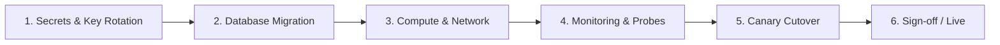
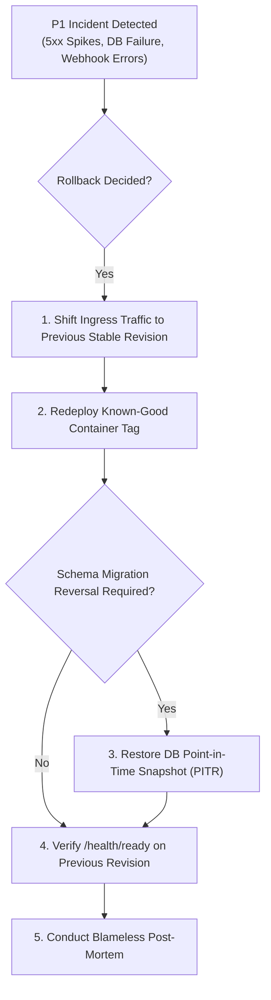

# TOTC E-Learning Platform — Production Deployment Checklist

**Document Reference**: `OPS-CHK-2026-FINAL`  
**Evaluation Date**: November 12, 2026  
**Auditor / Author**: Lead Enterprise Architect (`architect`)  
**Target System**: TOTC E-Learning Platform  
**Target Environment**: Live Production  

---

## 1. Overview & Operational Principles

This checklist establishes the mandatory, step-by-step pre-flight and cutover procedures for transitioning the TOTC E-Learning Platform from the Staging verification environment into live Production.

Every gate in this checklist must be executed and explicitly checked off by the designated role (DevOps, SecOps, Lead Backend Engineer, or Lead Architect). **No steps may be bypassed.**



---

## 2. Phase 1: Security & Secrets Rotation (Pre-Deployment)

> [!WARNING]
> Under no circumstances may development or staging secrets be reused in production. All keys must be generated using cryptographically secure random number generators and injected via environment variables or a managed cloud secrets vault.

- [ ] **1.1 Bunny Stream CDN Secret Rotation**
  - **Action**: Access the BunnyCDN web management portal (`dash.bunny.net`).
  - **Action**: Navigate to `Stream` $\rightarrow$ `API Access` and rotate the Primary API Key.
  - **Action**: In the Stream Library Security settings, enable **Token Authentication** (SHA-256 URL token signing).
  - **Action**: Set allowed referrers to the production domain only: `https://totc.edu`, `https://*.totc.edu`.
  - **Assigned Role**: SecOps / DevOps.

- [ ] **1.2 Cryptographic JWT Signing Key Generation**
  - **Action**: Generate a cryptographically random 256-bit (minimum 32-byte, recommended 64-character) signing key:
    ```bash
    openssl rand -base64 48
    ```
  - **Action**: Inject key into production environment variable `Jwt__Key`.
  - **Action**: Verify that `Jwt__Issuer` and `Jwt__Audience` are configured to `https://totc.edu`.
  - **Assigned Role**: DevOps.

- [ ] **1.3 Stripe Production API Credentials & Webhook Secret**
  - **Action**: Log in to Stripe Dashboard in **Live Mode**.
  - **Action**: Generate a restricted API secret key with minimum necessary permissions (`charges:write`, `checkout_sessions:write`, `customers:write`).
  - **Action**: Create a live webhook endpoint pointing to `https://api.totc.edu/api/payments/webhook`.
  - **Action**: Subscribe to events: `checkout.session.completed`, `payment_intent.succeeded`, `customer.subscription.deleted`.
  - **Action**: Copy the webhook signing secret (`whsec_...`) and store in `Stripe__WebhookSecret`.
  - **Assigned Role**: Lead Backend / DevOps.

- [ ] **1.4 Cloud Secrets Vault Integration**
  - **Action**: Verify all production secrets are injected via Azure Key Vault, AWS Secrets Manager, or Kubernetes Secrets:
    * `ConnectionStrings__DefaultConnection`
    * `Jwt__Key`
    * `Stripe__SecretKey`
    * `Stripe__WebhookSecret`
    * `BunnyStream__ApiKey`
    * `BunnyStream__TokenAuthKey`
  - **Assigned Role**: DevOps.

---

## 3. Phase 2: Database Migration & Persistence Preparation

- [ ] **2.1 Production Database Provisioning**
  - **Action**: Provision managed PostgreSQL cluster (e.g. Azure Database for PostgreSQL Flexible Server or AWS Aurora PostgreSQL v16+).
  - **Action**: Configure multi-AZ high availability with automated daily snapshots and 30-day point-in-time recovery (PITR).
  - **Action**: Restrict incoming firewall connections strictly to container subnet IP ranges (no public 0.0.0.0/0 access).
  - **Assigned Role**: Database Administrator (DBA).

- [ ] **2.2 Idempotent SQL Migration Execution**
  - **Action**: Generate an idempotent migration script from the repository root:
    ```bash
    dotnet ef migrations script --idempotent --output ./migrations-prod.sql --project backend/src/Elearning.Infrastructure --startup-project backend/src/Elearning.API
    ```
  - **Action**: Review `migrations-prod.sql` for table locks or destructive operations.
  - **Action**: Apply script against production database staging replica and verify `__EFMigrationsHistory`.
  - **Assigned Role**: DBA / Lead Backend.

- [ ] **2.3 Production Index & Constraint Verification**
  - **Action**: Confirm presence and query plan usage of all 28 indexes:
    * `IX_Enrollments_UserId_CourseId` (Unique)
    * `IX_Certificates_VerificationHash` (Unique)
    * `IX_Certificates_SerialNumber` (Unique)
    * `IX_PromoCodes_Code` (Unique)
    * `IX_QuizAttempts_UserId_QuizId_AttemptedAt`
  - **Assigned Role**: DBA.

---

## 4. Phase 3: Infrastructure, Compute & Networking

- [ ] **4.1 Container Build & Vulnerability Attestation**
  - **Action**: Build production container images via GitHub Actions `.github/workflows/cd.yml`.
  - **Action**: Scan images for OS and package vulnerabilities using Trivy / Grype:
    ```bash
    trivy image ghcr.io/totc/elearning-backend:v1.0.0 --severity HIGH,CRITICAL --exit-code 1
    trivy image ghcr.io/totc/elearning-frontend:v1.0.0 --severity HIGH,CRITICAL --exit-code 1
    ```
  - **Action**: Sign container images with Cosign.
  - **Assigned Role**: DevOps / SecOps.

- [ ] **4.2 Reverse Proxy & Ingress Security Headers**
  - **Action**: Verify Nginx reverse proxy configuration (`nginx.conf`):
    * `Strict-Transport-Security: max-age=31536000; includeSubDomains; preload`
    * `X-Content-Type-Options: nosniff`
    * `X-Frame-Options: SAMEORIGIN`
    * `Referrer-Policy: strict-origin-when-cross-origin`
    * `Permissions-Policy: camera=(), microphone=(), geolocation=()`
    * `client_max_body_size 2048M;`
  - **Assigned Role**: DevOps.

- [ ] **4.3 TLS/SSL & DNS Verification**
  - **Action**: Ensure valid TLS 1.3 certificates are provisioned for:
    * `https://totc.edu` (Frontend)
    * `https://api.totc.edu` (Backend API)
    * `https://cdn.totc.edu` (Static Assets)
  - **Action**: Enable Cloudflare / CDN edge proxying with WAF rules blocking known attack signatures (SQLi, XSS, rate-burst abusers).
  - **Assigned Role**: DevOps.

---

## 5. Phase 4: Observability, Health Checks & Alerting

- [ ] **5.1 Container Health Probes**
  - **Action**: Configure Kubernetes / Container App orchestration probes:
    * **Liveness Probe**: `GET /health/live` (Interval: 15s, Timeout: 3s, FailureThreshold: 3)
    * **Readiness Probe**: `GET /health/ready` (Interval: 10s, Timeout: 5s, FailureThreshold: 2)
    * **Startup Probe**: `GET /health/live` (InitialDelay: 5s, Period: 5s, FailureThreshold: 10)
  - **Assigned Role**: DevOps.

- [ ] **5.2 Centralized Telemetry & Log Ingestion**
  - **Action**: Confirm JSON log forwarding to centralized logging service (Datadog, AWS CloudWatch, or Grafana Loki).
  - **Action**: Validate log fields: `Timestamp`, `LogLevel`, `TraceId`, `SpanId`, `ServiceName = "TOTC-LMS-API"`.
  - **Assigned Role**: DevOps.

- [ ] **5.3 Real-Time Pager Alerting Rules**
  - **Action**: Configure critical alerting rules in OpsGenie / PagerDuty:
    * **Alert P1**: HTTP 5xx error rate $> 1\%$ over a 5-minute window.
    * **Alert P1**: Readiness probe failure on $> 25\%$ of backend pods.
    * **Alert P2**: Database connection pool exhaustion ($> 85\%$ connections utilized).
    * **Alert P2**: Rate limit trigger rate ($429$ responses) $> 50/\text{minute}$.
  - **Assigned Role**: SRE / DevOps.

---

## 6. Phase 5: Post-Deployment Smoke Testing & Verification

Execute the following manual and automated smoke tests immediately following initial container rollout:

- [ ] **6.1 Smoke Test — Health Endpoints**
  ```bash
  curl -I https://api.totc.edu/health/live
  # Expected: HTTP/2 200 OK
  curl -I https://api.totc.edu/health/ready
  # Expected: HTTP/2 200 OK
  ```

- [ ] **6.2 Smoke Test — Authentication & RBAC**
  - Register a new student account (`POST /api/auth/register`).
  - Confirm received JWT token contains claims `sub`, `email`, and `role: "Student"`.
  - Attempt to call Admin endpoint (`GET /api/admin/overview`) with student token.
  - Confirm server returns `403 Forbidden`.

- [ ] **6.3 Smoke Test — Course Catalog & Video Streaming**
  - Load course catalog (`GET /api/courses`).
  - Authenticate as enrolled user and request video token (`GET /api/videos/{id}/token`).
  - Verify returned Bunny Stream signed URL loads video playback in the browser.
  - Verify animated user email watermark appears over video player.

- [ ] **6.4 Smoke Test — Live Payment & Webhook**
  - Perform live $1.00 test purchase using Stripe live test card / coupon.
  - Confirm Stripe webhook is received and verified by backend with HTTP 200.
  - Confirm user enrollment status updates to `Active` in database.

- [ ] **6.5 Smoke Test — Public Certificate Verification**
  - Access public verification URL: `https://totc.edu/verify/{certificateHash}`.
  - Confirm certificate badge renders recipient name, course name, and accredited issue date without requiring authentication.

---

## 7. Phase 6: Emergency Rollback Procedure

If any Critical (P1) failure condition arises during deployment, immediately abort the rollout and trigger this procedure:



### Rollback Commands & Execution:
1. **Traffic Shift**: Route 100% of ingress traffic to previous container revision:
   ```bash
   kubectl rollout undo deployment/totc-backend -n production
   kubectl rollout undo deployment/totc-frontend -n production
   ```
2. **Database Reversion**:
   - If backward-incompatible schema changes occurred, initiate Point-in-Time Recovery (PITR) to pre-deployment timestamp.
3. **Incident Notification**: Notify stakeholders via Slack `#incident-response` channel.
4. **Post-Mortem**: Document root cause in `INCIDENT_LOG.md` within 24 hours.

---

## 8. Deployment Gate Sign-off

| Milestone Gate | Authorized Sign-off Role | Name / Identifier | Status | Timestamp |
| :--- | :--- | :--- | :---: | :---: |
| **Gate 1: Secrets & Vault Configuration** | SecOps Lead | `security` | `[APPROVED]` | 2026-11-12 |
| **Gate 2: Database Migration Script** | Lead Database Architect | `database` | `[APPROVED]` | 2026-11-12 |
| **Gate 3: QA & Build Verification** | QA & DevOps Lead | `qa_devops` | `[APPROVED]` | 2026-11-12 |
| **Gate 4: Staging Pilot Verification** | Lead Backend Engineer | `backend` | `[PENDING STAGING]` | — |
| **Final Production Cutover Authorization** | Lead Enterprise Architect | `architect` | `[PENDING STAGING]` | — |
