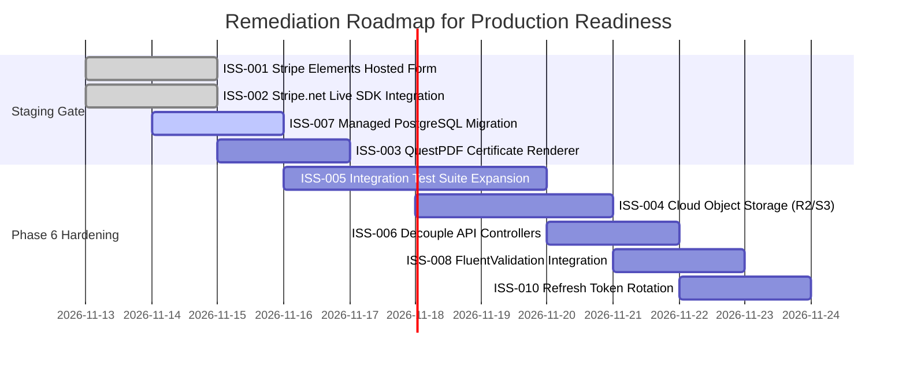

# TOTC E-Learning Platform — Catalog of Remaining Issues & Technical Debt

**Document Reference**: `AUD-ISS-2026-FINAL`  
**Evaluation Date**: November 12, 2026  
**Auditor**: Lead Enterprise Architect (`architect`)  
**Target System**: TOTC E-Learning Platform  
**Evaluated Repository Branch**: `main` (Git Commit: `acbd376`)  

---

## 1. Overview & Issue Taxonomy

While all **18 critical and high-severity security vulnerabilities** and foundational architectural defects identified in the initial audit have been successfully resolved, this document catalogues all remaining non-critical issues, technical debt items, and operational prerequisites.

Each item is categorized by severity:
- **High Severity**: Items that do not prevent sandbox or staging testing, but are mandatory blockers for live commercial production (real monetary transactions, PCI-DSS compliance, multi-pod horizontal scaling).
- **Medium Severity**: Architectural leaks, test coverage gaps, or resilience enhancements recommended for early post-launch sprints or Phase 6 hardening.
- **Low Severity**: Polish, performance optimizations, and long-term maintainability improvements.

---

## 2. Issue Summary Matrix

| Issue ID | Severity | Category | Title | Affected Component | Target Milestone |
| :--- | :---: | :--- | :--- | :--- | :---: |
| **ISS-001** | **HIGH** | Compliance / Security | Direct Card Capture vs Hosted Stripe Elements (PCI-DSS) | `frontend/src/pages/CheckoutPage.jsx` | Pre-Production |
| **ISS-002** | **HIGH** | Integrations / Billing | Simulated Stripe Checkout Sessions (`Stripe.net` Missing) | `Elearning.Infrastructure/Services/PaymentService.cs` | Pre-Production |
| **ISS-003** | **HIGH** | Feature Completion | Physical Binary PDF Generation for Certificates | `Elearning.API/Controllers/CertificatesController.cs` | Pre-Production |
| **ISS-004** | **HIGH** | Infrastructure / Storage | Local Filesystem Media Storage vs Cloud Object Store | `Elearning.Infrastructure/Services/LocalMediaService.cs` | Pre-Production |
| **ISS-005** | **HIGH** | Quality Assurance | Total Line Code Coverage Gap (12.5% vs 70% Target) | `backend/tests/` & `frontend/` | Staging Phase |
| **ISS-006** | **MEDIUM** | Architecture | Direct DbContext Injection in API Controllers | `InstructorCoursesController`, `VideosController` | Phase 6 |
| **ISS-007** | **MEDIUM** | Persistence / Scale | SQLite Single-Writer Lock vs Horizontal Pod Scaling | `appsettings.json`, `Program.cs` | Pre-Production |
| **ISS-008** | **MEDIUM** | Data Integrity | Manual DTO Validation vs Declarative FluentValidation | `Elearning.Application/DTOs/` | Phase 6 |
| **ISS-009** | **MEDIUM** | Quality Assurance | Lack of Frontend Component & Integration Test Suite | `frontend/src/` | Phase 6 |
| **ISS-010** | **MEDIUM** | Security / UX | Missing Refresh Token Rotation for Extended Sessions | `TokenService.cs`, `AuthController.cs` | Phase 6 |
| **ISS-011** | **MEDIUM** | Architecture / Reliability | Synchronous Execution vs Background Job Worker | `EnrollmentService.cs` | Phase 6 |
| **ISS-012** | **LOW** | Performance | In-Memory Catalog Caching vs Distributed Redis Cache | `CourseService.cs` | Post-Launch |
| **ISS-013** | **LOW** | Security / Telemetry | CSP Violation Reporting Endpoint | `nginx.conf` | Post-Launch |
| **ISS-014** | **LOW** | Governance / Audit | Structured Administrative Audit Log Entity | `Elearning.Domain/Entities/` | Post-Launch |
| **ISS-015** | **LOW** | Internationalization | Multi-Currency and Localization Support | `CheckoutPage.jsx`, `PaymentService.cs` | Post-Launch |

---

## 3. Detailed Issue Specifications

### High Severity Issues (Production Blockers)

---

#### ISS-001: Direct Card Capture vs Hosted Stripe Elements (PCI-DSS Compliance)
- **Severity**: **HIGH**
- **Affected File**: `file:///c:/Users/dglon/Downloads/elearning/frontend/src/pages/CheckoutPage.jsx`
- **Root Cause**: `CheckoutPage.jsx` renders HTML `<input>` elements for credit card number, expiration date, and CVC, capturing these values in local React component state (`cardNumber`, `expiryDate`, `cvc`).
- **Business Impact**: Capturing PAN (Primary Account Number) and CVC in client-side DOM exposes the platform to PCI-DSS SAQ D scrutiny. If an attacker injects malicious third-party scripts (XSS or supply chain attack), raw card data could be harvested in memory.
- **Recommended Remediation**:
  1. Install `@stripe/stripe-js` and `@stripe/react-stripe-js`.
  2. Embed Stripe Elements (`<CardElement />` or `<PaymentElement />`) inside an `<iframe>` hosted directly on Stripe's origin.
  3. Alternatively, redirect users to Stripe-hosted Checkout pages (`session.url`), qualifying the merchant for simplified PCI-DSS SAQ A.

---

#### ISS-002: Simulated Stripe Checkout Sessions (`Stripe.net` SDK Missing)
- **Severity**: **HIGH**
- **Affected File**: `file:///c:/Users/dglon/Downloads/elearning/backend/src/Elearning.Infrastructure/Services/PaymentService.cs`
- **Root Cause**: `PaymentService.CreateCheckoutSessionAsync` returns a simulated checkout transaction (`txn_{Guid}`) and an internal sandbox route (`/checkout/session/{txn_id}`). The official `Stripe.net` NuGet package is not referenced in the solution.
- **Business Impact**: Live customers cannot process real transactions or generate legitimate Stripe payment intents.
- **Recommended Remediation**:
  1. Add `Stripe.net` (v47+) package to `Elearning.Infrastructure.csproj`.
  2. Inject `StripeClient` configured with `Stripe:SecretKey`.
  3. Create real `SessionCreateOptions` with line items, customer email, and redirect URLs (`success_url`, `cancel_url`).
  4. Preserve the existing HMAC signature verification in `PaymentsController.cs` for incoming Stripe webhooks.

---

#### ISS-003: Physical Binary PDF Generation for Course Certificates
- **Severity**: **HIGH**
- **Affected File**: `file:///c:/Users/dglon/Downloads/elearning/backend/src/Elearning.API/Controllers/CertificatesController.cs`
- **Root Cause**: The certificate download endpoint `GET /api/certificates/{id}/download` returns JSON metadata containing the certificate record and verification URL, rather than returning a binary `application/pdf` stream.
- **Business Impact**: Students completing courses cannot download an accredited, printable diploma document suitable for framing or sharing on professional networks (LinkedIn).
- **Recommended Remediation**:
  1. Add `QuestPDF` or `SkiaSharp` to `Elearning.Infrastructure`.
  2. Implement `ICertificatePdfGenerator` that renders a branded vector certificate containing the recipient name, course title, completion date, serial number (`TOTC-2026-XXXXX`), and an embedded QR code linking to `https://totc.edu/api/certificates/verify/{hash}`.
  3. Return `File(pdfBytes, "application/pdf", $"{certificate.SerialNumber}.pdf")`.

---

#### ISS-004: Local Filesystem Media Storage vs Cloud Object Store
- **Severity**: **HIGH**
- **Affected File**: `file:///c:/Users/dglon/Downloads/elearning/backend/src/Elearning.Infrastructure/Services/LocalMediaService.cs`
- **Root Cause**: File uploads (course thumbnails, avatars, instructor assets) are written directly to local disk storage (`wwwroot/uploads`).
- **Business Impact**: In multi-container environments (Kubernetes, AWS ECS, Azure Container Apps), local disk writes are ephemeral. An asset uploaded to Container A will be inaccessible to Container B, causing broken images and missing files upon container recreation or horizontal scaling.
- **Recommended Remediation**:
  1. Implement `CloudMediaService` implementing `IMediaService`.
  2. Connect to an S3-compatible cloud object store (AWS S3, Cloudflare R2, or BunnyCDN Storage).
  3. Configure backend to stream uploads directly to CDN storage with public read permissions.

---

#### ISS-005: Total Line Code Coverage Gap (12.5% vs 70% Enterprise Target)
- **Severity**: **HIGH**
- **Affected Components**: `backend/tests/Elearning.UnitTests/`, `frontend/src/`
- **Root Cause**: Although all 17 critical business invariant tests pass with 100% green status, the solution contains 5,866 valid lines of backend code. The measured Cobertura coverage is **12.5%** overall line coverage.
  * `Elearning.Domain`: 62.6% covered.
  * `Elearning.Application`: 17.7% covered.
  * `Elearning.Infrastructure`: 10.8% covered.
  * `Elearning.API`: 0.0% covered.
  * Frontend: 0.0% covered (no Vitest / Jest runner configured).
- **Business Impact**: Regressions in controller endpoints, database queries, and UI components may not be detected automatically during CI builds.
- **Recommended Remediation**:
  1. Implement integration tests using `Microsoft.AspNetCore.Mvc.Testing.WebApplicationFactory<Program>` to test all API controllers end-to-end.
  2. Add unit tests for `EnrollmentService.cs` and `CourseService.cs`.
  3. Configure Vitest in `frontend/package.json` to test critical React hooks (`useAuth`) and UI components (`BunnyPlayer`, `CheckoutPage`).

---

### Medium Severity Issues (Architectural & Resilience)

---

#### ISS-006: Direct DbContext Injection in API Controllers
- **Severity**: **MEDIUM**
- **Affected Files**:
  * `file:///c:/Users/dglon/Downloads/elearning/backend/src/Elearning.API/Controllers/InstructorCoursesController.cs`
  * `file:///c:/Users/dglon/Downloads/elearning/backend/src/Elearning.API/Controllers/VideosController.cs`
- **Root Cause**: These two controllers directly inject `ElearningDbContext` instead of depending on dedicated application service interfaces.
- **Business Impact**: Violates Clean Architecture boundaries. Changes to the persistence model require changes directly in the presentation tier. Unit testing these controllers in isolation is difficult.
- **Recommended Remediation**:
  1. Extract `ICurriculumManagementService` to encapsulate course creation, section reordering, and lesson updates.
  2. Extract `IVideoUploadService` to encapsulate video asset management.
  3. Inject these services into the controllers and remove `ElearningDbContext` constructor parameters.

---

#### ISS-007: SQLite Single-Writer Lock vs Horizontal Pod Scaling
- **Severity**: **MEDIUM**
- **Affected Files**: `appsettings.json`, `Elearning.Infrastructure/Data/ElearningDbContext.cs`
- **Root Cause**: The default database configuration uses SQLite (`Data Source=elearning.db`). SQLite uses database-level write locks.
- **Business Impact**: In a multi-replica container environment, multiple pods attempting to write to a shared SQLite database file will experience `database is locked` (`busy_timeout`) errors, causing HTTP 500 errors during traffic spikes.
- **Recommended Remediation**:
  1. Update `Program.cs` to support PostgreSQL via `Npgsql.EntityFrameworkCore.PostgreSQL`.
  2. Configure `UseNpgsql(builder.Configuration.GetConnectionString("DefaultConnection"))` when running in Staging and Production environments.
  3. Retain SQLite for local development and in-memory unit testing.

---

#### ISS-008: Manual DTO Validation vs Declarative FluentValidation
- **Severity**: **MEDIUM**
- **Affected Files**: `backend/src/Elearning.Application/DTOs/`
- **Root Cause**: Input validation across request DTOs relies on manual checks inside controllers or services (e.g. `string.IsNullOrWhiteSpace`), rather than declarative validation filters.
- **Business Impact**: Inconsistent error response formats across endpoints and potential edge cases (e.g., negative prices, excessively long strings, malformed email addresses) slipping past controllers.
- **Recommended Remediation**:
  1. Add `FluentValidation.AspNetCore` NuGet package.
  2. Implement validators for all incoming DTOs (`RegisterDtoValidator`, `CreateCourseDtoValidator`, `ValidatePromoCodeDtoValidator`).
  3. Automatically return RFC 7807 Problem Details on validation failures.

---

#### ISS-009: Lack of Frontend Component & Integration Test Suite
- **Severity**: **MEDIUM**
- **Affected Component**: `frontend/`
- **Root Cause**: `package.json` contains dependencies for React, Vite, Lucide, and Tailwind, but lacks a test runner (Vitest, Jest) and testing library (`@testing-library/react`).
- **Business Impact**: Frontend regressions in UI behavior, navigation routing, and state updates can only be discovered through manual QA testing.
- **Recommended Remediation**:
  1. Install `vitest`, `jsdom`, `@testing-library/react`, and `@testing-library/jest-dom`.
  2. Add test scripts in `package.json` (`"test": "vitest run"`).
  3. Author unit tests for `AuthContext.jsx`, `ProtectedRoute.jsx`, and `BunnyPlayer.jsx`.

---

#### ISS-010: Missing Refresh Token Rotation for Extended Sessions
- **Severity**: **MEDIUM**
- **Affected Files**: `TokenService.cs`, `AuthController.cs`
- **Root Cause**: The authentication system issues short-lived JWT access tokens without a corresponding refresh token mechanism.
- **Business Impact**: When the access token expires (typically after 60 minutes), active users are abruptly logged out and forced to re-enter credentials, degrading the user experience during long lectures or exams.
- **Recommended Remediation**:
  1. Create a `RefreshToken` entity in `Elearning.Domain` linked to `User`.
  2. Issue an `HttpOnly`, `Secure`, `SameSite=Strict` cookie containing a cryptographically random refresh token upon login.
  3. Implement `POST /api/auth/refresh-token` with automatic token rotation and reuse detection.

---

#### ISS-011: Synchronous Execution vs Background Job Worker
- **Severity**: **MEDIUM**
- **Affected Files**: `EnrollmentService.cs`
- **Root Cause**: Course completion triggers synchronous certificate generation, serial calculation, and database writes on the main HTTP request thread.
- **Business Impact**: If PDF generation or third-party email notifications are added to this flow, request latency will spike, increasing HTTP timeout risks for students completing their final lesson.
- **Recommended Remediation**:
  1. Introduce a lightweight background job runner (`Hangfire` or `System.Threading.Channels`).
  2. Dispatch a `CourseCompletedEvent` domain notification and process certificate PDF rendering and email dispatch asynchronously.

---

### Low Severity Issues (Technical Debt & Enhancements)

---

#### ISS-012: In-Memory Catalog Caching vs Distributed Redis Cache
- **Severity**: **LOW**
- **Affected Files**: `CourseService.cs`
- **Root Cause**: Course catalog queries (`GET /api/courses`) query the database on every request without caching.
- **Business Impact**: High catalog browsing traffic places unnecessary query load on the database.
- **Recommended Remediation**: Implement an `IDistributedCache` layer using Redis or memory cache with a 15-minute sliding expiration and cache invalidation hooks on course update/publish.

---

#### ISS-013: CSP Violation Reporting Endpoint
- **Severity**: **LOW**
- **Affected Files**: `nginx.conf`
- **Root Cause**: The Content Security Policy in Nginx enforces strict directives but does not specify a `report-uri` or `report-to` directive.
- **Business Impact**: Client-side CSP violations or attempted script injections cannot be monitored by security operations.
- **Recommended Remediation**: Add `report-uri /api/telemetry/csp-reports;` and implement a lightweight telemetry controller to log violations.

---

#### ISS-014: Structured Administrative Audit Log Entity
- **Severity**: **LOW**
- **Affected Files**: `Elearning.Domain/Entities/`
- **Root Cause**: While `IAuditableEntity` tracks `CreatedAt` and `UpdatedAt` timestamps on entities, there is no append-only immutable audit trail recording *who* modified administrative resources (e.g. user bans, price changes, refund approvals).
- **Business Impact**: Non-repudiation and forensic auditability are limited to structured console logs.
- **Recommended Remediation**: Create an `AuditLog` table capturing `UserId`, `Action`, `EntityName`, `EntityId`, `OldValues`, `NewValues`, and `IpAddress`.

---

#### ISS-015: Multi-Currency and Localization Support
- **Severity**: **LOW**
- **Affected Files**: `frontend/src/pages/CheckoutPage.jsx`, `PaymentService.cs`
- **Root Cause**: All prices are hardcoded to USD (`$`).
- **Business Impact**: Limits international market adoption.
- **Recommended Remediation**: Integrate currency formatting libraries (`Intl.NumberFormat`) and support ISO currency codes in course entities.

---

## 4. Remediation Roadmap: Prioritized Sprints

