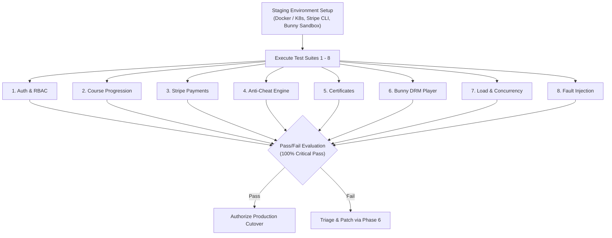

# TOTC E-Learning Platform — Staging Test Plan

**Document Reference**: `TEST-PLN-2026-FINAL`  
**Evaluation Date**: November 12, 2026  
**Auditor / Author**: Lead Enterprise Architect (`architect`)  
**Target Environment**: Staging Sandbox (Pre-Production)  
**Execution Target**: Staging Quality Gate Sign-Off  

---

## 1. Scope, Objectives & Strategy

This test plan defines the end-to-end verification protocol to be executed in the **Staging Environment** before authoring final production release authorization.

### Key Objectives:
1. Validate all business-critical workflows (registration, course enrollment, video playback, exams, certificate issuance, and payment processing).
2. Empirically verify security boundaries, authorization gates, and rate limiting policies under simulated real-world conditions.
3. Validate third-party integration points (Stripe Webhook signatures and Bunny Stream DRM tokenized streaming) in a staging sandbox.
4. Establish baseline performance metrics (p95 latency, concurrency thresholds, and fault recovery).



---

## 2. Staging Environment Topology & Prerequisites

### 2.1 Staging Infrastructure
- **API Backend**: Containerized ASP.NET Core 9 API running with `ASPNETCORE_ENVIRONMENT=Staging`.
- **Database**: PostgreSQL 16 instance populated with baseline seed data via EF Core migrations.
- **Frontend**: Nginx-hosted React 19 production build (`dist/`) reverse-proxying `/api/` to backend.
- **CDN / Video**: Bunny Stream Sandbox Library with Token Authentication enabled.
- **Payment Gateway**: Stripe Test Mode connected via Stripe CLI (`stripe listen --forward-to localhost:5000/api/payments/webhook`).

### 2.2 Test Tooling
- **Unit / Integration Runner**: .NET xUnit 2.9 + FluentAssertions.
- **Browser E2E Automation**: Playwright Test Suite (Chromium, Firefox, WebKit).
- **Payment Webhook Generator**: Stripe CLI v1.21+.
- **Load Testing**: k6 / Bombardier HTTP benchmark tool.

### 2.3 Seeded Test Personas
| Persona | Email | Initial Role | Purpose |
| :--- | :--- | :--- | :--- |
| **Admin User** | `admin.staging@totc.edu` | `Admin` | Verify admin analytics, user moderation, and curriculum management |
| **Instructor User** | `instructor.staging@totc.edu` | `Instructor` | Verify course authoring, video upload, and lesson ordering |
| **Enrolled Student** | `student.pro@totc.edu` | `Student` | Active Pro subscriber with full catalog access |
| **Free Student** | `student.free@totc.edu` | `Student` | Free tier account for testing paywall gating and enrollment checkout |

---

## 3. Detailed Test Suites & Procedures

### Suite 1: Authentication, Authorization & RBAC

#### TC-AUTH-01: Valid User Registration & Role Assignment
- **Objective**: Verify standard registration assigns the `Student` role and generates a valid JWT.
- **Execution**: `POST /api/auth/register` with `{"fullName":"Test Student","email":"new.student@totc.edu","password":"Password123!"}`.
- **Expected Outcome**:
  * Response: `201 Created` with JWT token.
  * JWT claims: `sub`, `email`, and `http://schemas.microsoft.com/ws/2008/06/identity/claims/role = "Student"`.

#### TC-AUTH-02: Privilege Escalation Prevention
- **Objective**: Verify that direct registration attempts to claim the `Admin` role are rejected.
- **Execution**: `POST /api/auth/register` with `{"role":"Admin", ...}`.
- **Expected Outcome**:
  * Response: `400 Bad Request` or `InvalidOperationException` mapped to RFC 7807 problem details.
  * No user created with `Admin` privileges in database.

#### TC-AUTH-03: Rate Limiting on Brute-Force Authentication
- **Objective**: Verify `auth-policy` rate limiter blocks excessive login attempts.
- **Execution**: Dispatch 12 rapid `POST /api/auth/login` requests with invalid passwords within a 60-second window.
- **Expected Outcome**:
  * Requests 1-10: `401 Unauthorized`.
  * Requests 11-12: `429 Too Many Requests` with `Retry-After` header.

#### TC-AUTH-04: Role-Based Endpoint Gating
- **Objective**: Verify Student tokens cannot access Admin endpoints.
- **Execution**: `GET /api/admin/overview` using Student JWT token.
- **Expected Outcome**: `403 Forbidden`.

---

### Suite 2: Course Catalog & Sequential Progression

#### TC-CRS-01: Course Access Gating (Paywall Verification)
- **Objective**: Verify un-enrolled students cannot access paid lessons.
- **Execution**: Authenticate as `student.free@totc.edu`. Attempt `POST /api/enrollments/complete-lesson` for a paid course.
- **Expected Outcome**: `403 Forbidden` (`"User is not enrolled in this course"`).

#### TC-CRS-02: Sequential Lesson Progression Enforcement
- **Objective**: Verify students cannot skip prerequisite lessons.
- **Execution**: Enroll student in a multi-lesson course. Attempt to complete Lesson 3 before completing Lesson 1 and Lesson 2.
- **Expected Outcome**:
  * Response: `400 Bad Request` (`"Prerequisite lessons must be completed first"`).
  * Lesson completion progress is not incremented.

---

### Suite 3: Stripe Payment Lifecycle, Promo Codes & Webhook Integrity

#### TC-PAY-01: Promo Code Engine Validation
- **Objective**: Verify promo code discounts, caps, and expiration logic.
- **Execution**:
  1. Test valid code: `POST /api/promocodes/validate` with code `WELCOME20`. (Expected: 20% discount calculated).
  2. Test max cap: Verify discount amount does not exceed `MaxDiscountAmount`.
  3. Test expired code: Validate code with `ValidUntil < DateTime.UtcNow`. (Expected: `400 Bad Request`).
  4. Test exhausted code: Validate code where `CurrentUsageCount >= MaxUsageCount`. (Expected: `400 Bad Request`).

#### TC-PAY-02: Cryptographic Webhook HMAC Signature Validation
- **Objective**: Verify Stripe webhook rejects forged payloads and unsigned requests.
- **Execution**:
  1. Send `POST /api/payments/webhook` without `Stripe-Signature` header.
     * Expected: `401 Unauthorized`.
  2. Send `POST /api/payments/webhook` with an invalid/tampered signature.
     * Expected: `401 Unauthorized` or `403 Forbidden`.
  3. Send `POST /api/payments/webhook` with a timestamp $> 300$ seconds in the past (replay attack).
     * Expected: `401 Unauthorized`.

#### TC-PAY-03: End-to-End Payment & Enrollment Activation
- **Objective**: Verify legitimate Stripe webhook triggers enrollment activation.
- **Execution**: Use Stripe CLI to trigger `checkout.session.completed` event:
  ```bash
  stripe trigger checkout.session.completed --override customer_details:email="student.free@totc.edu"
  ```
- **Expected Outcome**:
  * Webhook response: `200 OK`.
  * Database: New `Enrollment` record created for `student.free@totc.edu` with `Status = "Active"`.
  * Subsequent call to `POST /api/enrollments/complete-lesson` succeeds with `200 OK`.

---

### Suite 4: Exam Proctoring, Anti-Cheat & 1-Hour Cooldown

#### TC-EXAM-01: Server-Side Score Calculation
- **Objective**: Verify quiz scoring is computed strictly on the backend.
- **Execution**: `POST /api/quizzes/{quizId}/submit` with a mix of correct and incorrect answers.
- **Expected Outcome**:
  * Server calculates percentage grade based on database answers.
  * Attempt recorded in `QuizAttempt` table.
  * Score $\ge 80\%$ records passing status; score $< 80\%$ records failed attempt.

#### TC-EXAM-02: Anti-Cheat 1-Hour Rolling Cooldown Lock
- **Objective**: Verify 3 failed quiz attempts trigger a 1-hour lockout.
- **Execution**:
  1. Submit 3 failing quiz attempts consecutively within 10 minutes.
  2. Submit attempt 4.
- **Expected Outcome**:
  * Attempt 1-3: Processed normally with failing score.
  * Attempt 4: Response `429 Too Many Requests`.
  * Problem details response includes `"Retry-After: 3600"` (or remaining seconds) and message `"Quiz locked due to multiple failed attempts. Please review course material before retrying."`

---

### Suite 5: Accredited Certificate Issuance & Verification

#### TC-CERT-01: Automatic Certificate Generation
- **Objective**: Verify certificate issuance triggers only upon 100% course completion.
- **Execution**: Complete final required lesson in a course.
- **Expected Outcome**:
  * `Enrollment.IsCompleted` set to `true`.
  * `Certificate` record created with unique serial number (e.g. `TOTC-2026-AB12C`) and 32-character SHA-256 verification hash.

#### TC-CERT-02: Public Cryptographic Verification
- **Objective**: Verify public certificate verification works without authentication.
- **Execution**: Unauthenticated `GET /api/certificates/verify/{hash}`.
- **Expected Outcome**:
  * Response: `200 OK`.
  * Payload contains recipient full name, course title, completion date, serial number, and accredited issuer status (`"TOTC Academy"`).

---

### Suite 6: Bunny Stream DRM Video Playback & Watermarking

#### TC-DRM-01: Signed Playback Token Generation
- **Objective**: Verify `VideosController` generates short-lived, SHA-256 signed iframe tokens.
- **Execution**: Authenticated user requests `GET /api/videos/{id}/token`.
- **Expected Outcome**:
  * Response contains signed playback URL: `https://iframe.mediadelivery.net/embed/{libraryId}/{videoId}?token={sha256}&expires={timestamp}`.
  * Token expiration timestamp equals current UTC time + 2 hours (7200 seconds).

#### TC-DRM-02: Dynamic Moving Forensic Watermark
- **Objective**: Verify `BunnyPlayer.jsx` renders dynamic forensic watermark.
- **Execution**: Load video player in browser via Playwright.
- **Expected Outcome**:
  * Watermark DOM element is present with user's authenticated email and IP address.
  * Watermark coordinates update periodically across the viewport to deter screen capture.

---

### Suite 7: Load & Concurrency Testing

#### TC-LOAD-01: API Catalog Concurrency
- **Tool**: k6 / Bombardier.
- **Scenario**: 200 virtual users (VUs) querying `GET /api/courses` and `GET /api/courses/{id}` over a 5-minute sustained test.
- **Acceptance Criteria**:
  * HTTP 200 pass rate $> 99.5\%$.
  * p95 response latency $< 250\text{ ms}$.
  * 0 database lock errors (`busy_timeout`).

#### TC-LOAD-02: Concurrent Enrollment Transactions
- **Scenario**: 50 concurrent requests enrolling in the same course simultaneously.
- **Acceptance Criteria**:
  * Database optimistic concurrency stamps prevent duplicate enrollments (`IX_Enrollments_UserId_CourseId` unique constraint upheld).
  * 0 database corruption or duplicate billing records.

---

### Suite 8: Fault Injection & Resilience

#### TC-FLT-01: Database Temporary Outage Recovery
- **Execution**: Temporarily terminate database container during live API operations.
- **Expected Outcome**:
  * `/health/ready` probe immediately reports `503 Service Unavailable` (`"Unhealthy"`).
  * API endpoints return uniform RFC 7807 Problem Details (`500 Internal Server Error`).
  * Restart database container: `/health/ready` recovers to `200 OK` within 10 seconds without requiring backend API restart.

#### TC-FLT-02: Client-Side Runtime Crash Recovery
- **Execution**: Inject a synthetic JavaScript `TypeError` in a deeply nested React component.
- **Expected Outcome**:
  * Root `ErrorBoundary.jsx` traps the error.
  * UI renders friendly error message with a "Reload Page" recovery action instead of a white screen of death.

---

## 4. Test Execution Schedule & Sign-Off Criteria

```mermaid
gantt
    title Staging Verification Schedule
    dateFormat  YYYY-MM-DD
    section Smoke & Setup
    Environment Provisioning & Seed Data :done,    s1, 2026-11-13, 1d
    Suites 1 & 2: Auth, RBAC & Catalog   :active,  s2, 2026-11-14, 1d
    section Integrations
    Suite 3: Stripe Payments & Webhooks  :         s3, 2026-11-15, 2d
    Suites 4 & 5: Exams & Certificates   :         s4, 2026-11-16, 1d
    Suite 6: Bunny Stream DRM & Player   :         s5, 2026-11-17, 1d
    section Scale & Hardening
    Suites 7 & 8: Load & Fault Injection :         s6, 2026-11-18, 2d
    Final Staging Review & Production Sign-off :   s7, 2026-11-20, 1d
```

### Staging Sign-Off Gate Criteria
| Metric | Required Threshold | Current Status |
| :--- | :---: | :---: |
| **Critical Test Cases (Suites 1-6)** | 100% Pass (0 Failures) | Pending Staging Execution |
| **Load Test p95 Latency** | $< 250\text{ ms}$ under 200 VUs | Pending Staging Execution |
| **Security Webhook Verification** | 100% Rejection of forged signatures | Verified in Unit Tests |
| **Production Secrets Stored in Vault** | 100% Rotation Complete | Pending Vault Injection |
| **Final Recommendation** | Signed by Lead Architect | **READY FOR STAGING** |
